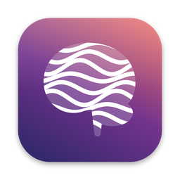
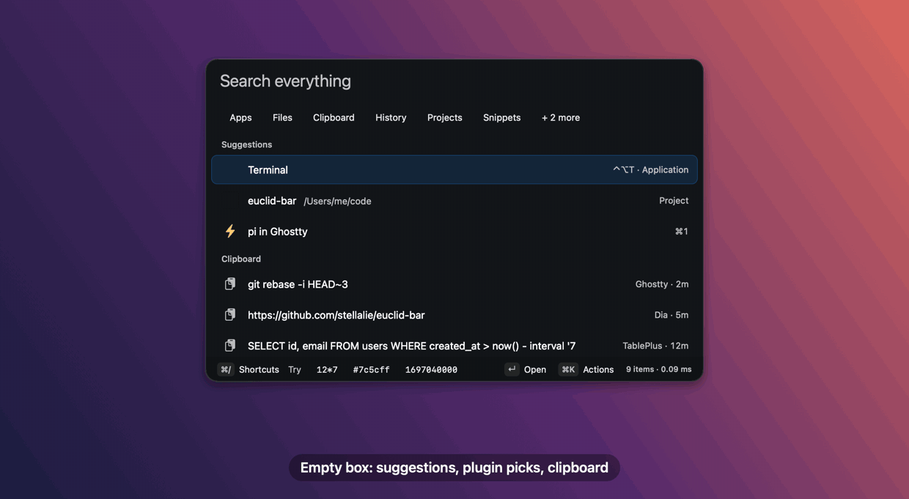
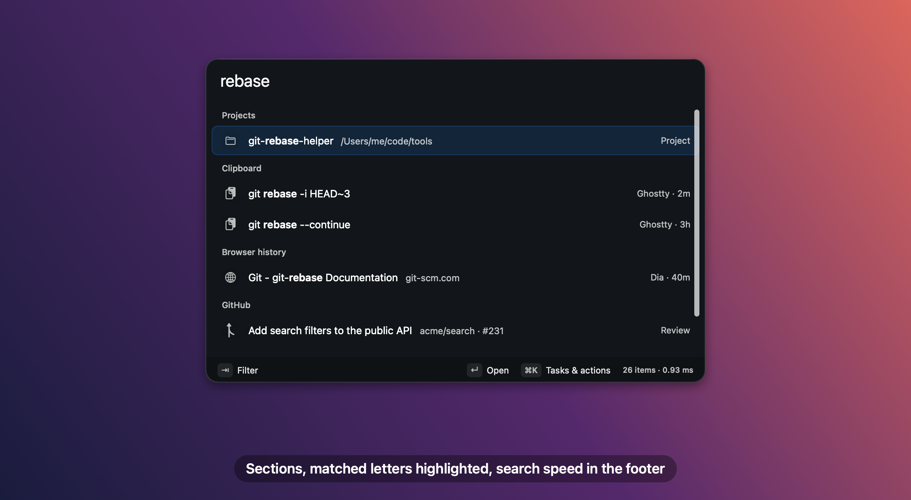
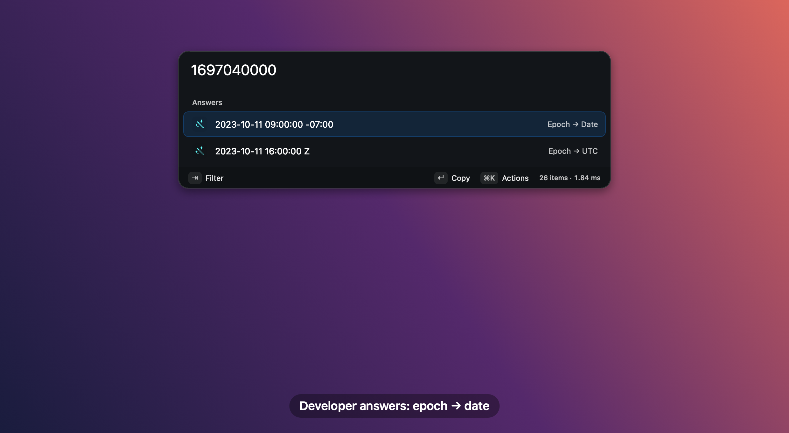
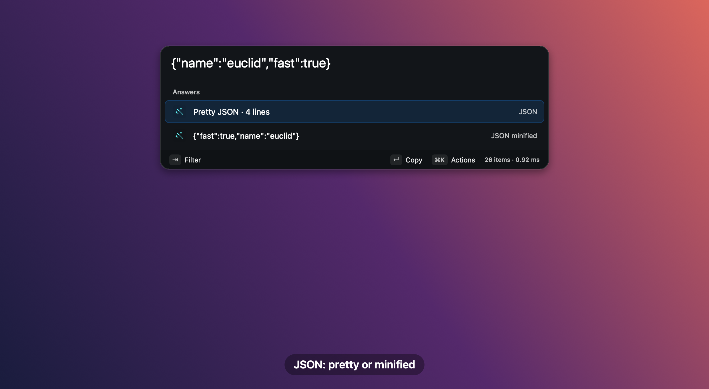
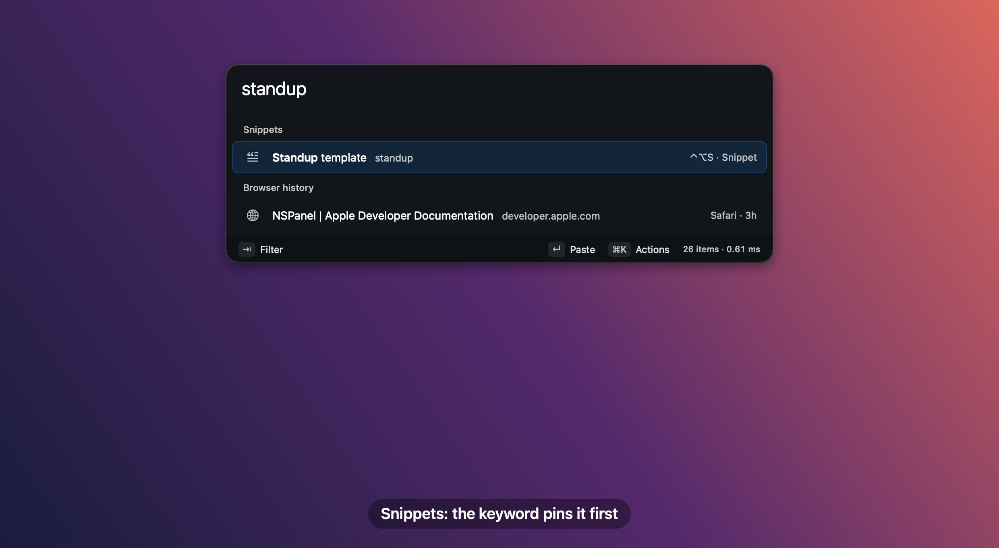
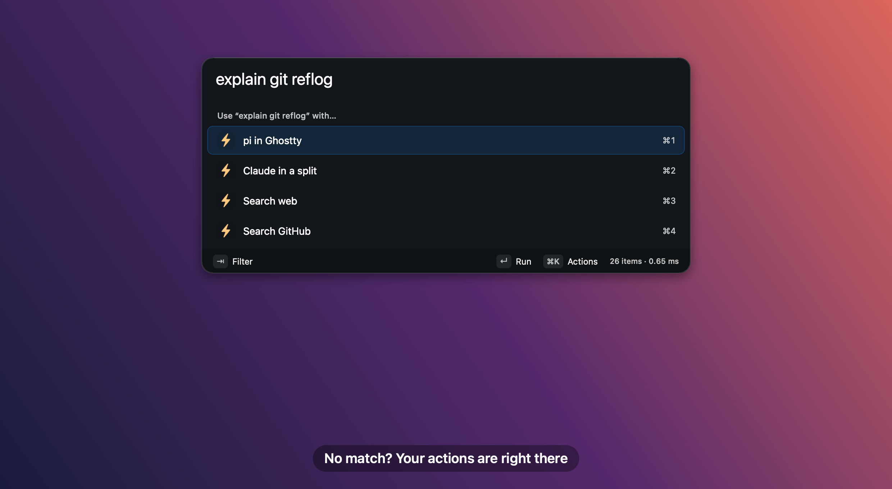
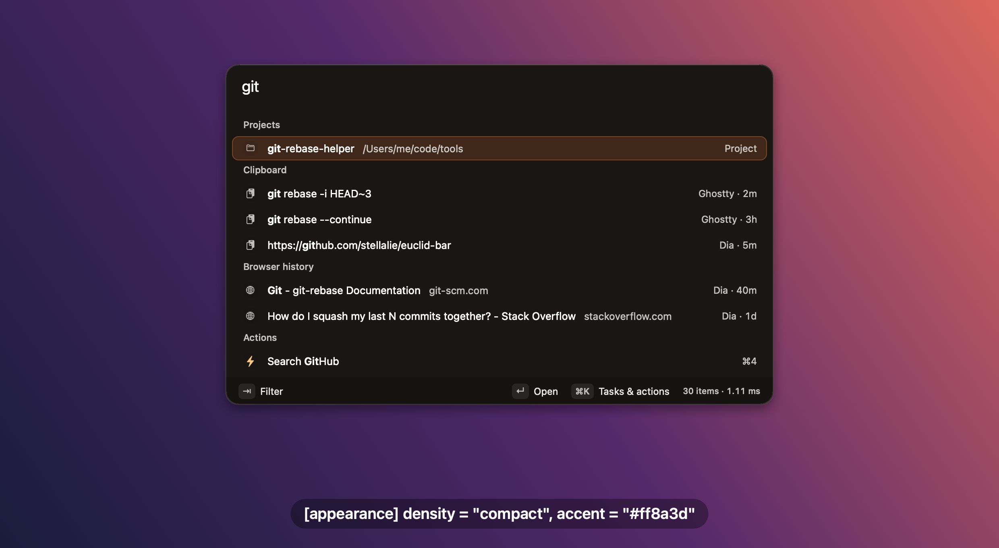
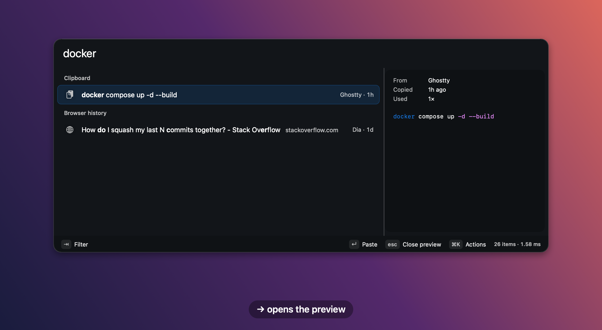

<div align="center">



# Meet Euclid

**The blazing fast, developer-first search bar for macOS.**<br>
Apps, projects, files, clipboard, browser history, notes, snippets, and plugins for the rest.
One keystroke, under a millisecond.

[**Download for macOS**](https://github.com/stellalie/euclid-bar-releases/releases/latest) · [Features](#features) · [Config](#configuration) · [Plugins](#plugins) · [Build from source](#build-from-source)



<sub>Every frame is the real panel, rendered offscreen by the app itself (`make screens`)</sub>

</div>

---

Press **`⌥Space`**. Type three letters. The command you copied an hour ago, the docs page you read
yesterday, the PR waiting on your review, the question you want to throw at your AI agent: it's all
one keystroke away. Then Euclid gets out of your way.

## Why Euclid

- ⚡ **Blazing fast.** Native Swift + AppKit. No Electron, no web views. Searches **10,000 items in
  1.4 ms** (worst case), shows the panel in ~9 ms, idles at 0% CPU and ~54 MB of RAM, measured by
  the Perf workflow on a GitHub macOS runner. The footer shows you the receipts: `26 items · 0.82 ms`.
- 🛠️ **Built for developers.** Every action is **one shell command** in a TOML file. Epochs, JSON,
  JWTs, base64 and colours are answered inline. First-class Ghostty; Bitbucket, Jira and GitHub as plugins.
- 🧩 **Config is a file, not a settings window.** `~/.config/euclid/config.toml`, dotfiles-friendly,
  applies on save, validated with `--check-config` in CI.
- 🔒 **Private by design.** Everything is indexed and stored on your Mac. Password-manager copies are
  never recorded. Browser history is read locally, read-only.

## Features

**One list, everything in it.** Results are grouped into sections with matched letters highlighted,
and the list never reshuffles under your cursor.

| Source | What you get |
|---|---|
| **Apps** | `/Applications`, `/System/Applications`, `~/Applications` and any folders you add |
| **Projects** | Git repos under your code folders; `↵` opens them in your editor of choice, `⌘K` runs their `make`/`npm`/`just`/`swift`/`cargo`/`go` tasks in a new terminal tab |
| **Files** | Spotlight, by name, after 3+ letters |
| **Clipboard** | Text, **images** and copied **files**, with the app and time they came from |
| **Browser history** | Dia, Arc, Chrome, Brave, Edge, Vivaldi, Chromium, Safari |
| **Obsidian** | Your notes by title and text; `↵` opens them in Obsidian |
| **Snippets** | Text you paste often, with `{date}` `{time}` `{datetime}` `{clipboard}` `{uuid}` placeholders |
| **Actions** | Your shell commands, run on what you typed |
| **Plugins** | Anything a script can print: [your own sources, answers and badges](#plugins) |

**Add only what you use.** These ship as plugins, so they cost nothing until you add one
with `euclid-bar --plugin add <name>`:

| Plugin | What you get |
|---|---|
| `github` *(plugin)* | Your PRs, review requests and issues, through the `gh` CLI; ⌘K copies, approves or comments; `gh <words>` searches as you type |
| `bitbucket` *(plugin)* | Your open PRs, PRs waiting on your review, your repos (Cloud and Data Center) |
| `jira` *(plugin)* | Issues assigned to you and ones you viewed lately; type `ABC-123` to open any issue |
| `linear` *(plugin)* | Linear issues assigned to you |
| `slack` *(plugin)* | Jump to channels; `slack <words>` searches messages |
| `contacts` *(plugin)* | People by name, company, email or phone; `↵` opens the card |
| `shortcuts` *(plugin)* | Run your Shortcuts by name |
| `define` *(plugin)* | `define serendipity` from the macOS Dictionary |
| `currency` *(plugin)* | `100 usd to eur` with daily rates (no key) |
| `tokens` *(plugin)* | Today's Claude Code tokens and cost on the bar, from `ccusage` |
| `cleanlinks` *(mod)* | Strips tracking parameters from links you copy |
| `reveal` *(mod)* | ⇧⌘R shows the selected file, project or app in Finder |
| `ai` *(mod)* | Your own AI, no API key: `ai <question>` answers in the bar; on a clip ⇧⌘F fixes the writing and pastes it back, ⇧⌘T translates, ⇧⌘E explains; ⇧⌘↵ on an answer continues the chat in a terminal with your AI CLI. Apple's on-device model by default (free, private; macOS 26), or the `claude`, `codex` or `gemini` CLI you're logged into, or any command (`ollama run …`) |
| `raycast` *(plugin)* | Runs your Raycast script commands: each is a row, `rc <name> <args>` runs one. Modes silent, compact, fullOutput and inline; typed arguments; confirmation |
| `emoji` *(plugin)* | An emoji grid; `emoji heart` lists matches. `↵` pastes |
| `volume` *(plugin)* | Volume Up, Down and Mute rows, `vol 40`, and Set Volume with a dropdown |
| `kill-process` *(plugin)* | Your processes, busiest first, refreshing live; `↵` quits one, `↵` again force-quits; `kill chrome` finds one |
| `docker` *(plugin)* | Your containers, live: logs (live too), a shell, open its port, start, stop, restart |

**Without opening the panel.** Type a snippet's keyword in any app and it turns into the snippet
(`[expansion] enabled`: opt-in, needs Accessibility). Give any app, project, action or snippet its
own hotkey in `[hotkeys]`; its row shows it.

**Answers as you type.** `↵` copies the answer.

| Type | Get |
|---|---|
| `12 * 3.5` · `1.5 gb in mb` · `72 f in c` | Calculator and unit conversions |
| `1697040000` · `2023-10-11T16:00:00Z` · `now` | Epoch ⇄ date |
| `{"a":1}` | Pretty and minified JSON |
| `eyJhbGciOi…` | Decoded JWT header and payload |
| `b64 hello` · `aGVsbG8gd29ybGQ=` | Base64 encode / decode |
| `a%20b` · `urlencode a b` | URL decode / encode |
| `#ff8800` · `rgb(255, 136, 0)` | The other notation, with a swatch |
| `uuid` | A fresh UUID |

**And the rest.**

- 👀 **Preview pane** (`→` or `⌘Y`): the full clip, images, Quick Look for files, a project's README,
  a note's text.
- 🧠 **Learns what you mean.** The result you pick for what you type ranks first next time. Give
  anything a short **alias** and pin **favorites** to the empty box.
- 🤖 **Agent-ready.** Nothing matches? Your actions show up instead, so a question is one `↵` away
  from `pi`, `claude` or any agent in a new Ghostty tab. And your agents can [search what
  Euclid knows](#your-agents-can-search-it-too) over MCP.
- 🎨 **Sharp and light.** Liquid Glass on macOS 26, a panel that grows with its results, your own
  accent colour, `comfortable` or `compact` density.
- 🧛 **[Themes](#themes)** from the editor schemes you already use: Dracula, Nord, Tokyo Night,
  Catppuccin, Gruvbox, Solarized, Monokai, or your own in one small TOML file.

## A closer look

<table>
<tr>
<td width="50%"><br><sub><b>Sections.</b> Matched letters highlighted, search time in the footer.</sub></td>
<td width="50%"><br><sub><b>Answers.</b> Paste an epoch, get the date.</sub></td>
</tr>
<tr>
<td><br><sub><b>Developer answers.</b> Paste JSON, get it pretty or minified.</sub></td>
<td><br><sub><b>Snippets.</b> The keyword pins it first; <code>↵</code> pastes.</sub></td>
</tr>
<tr>
<td><br><sub><b>No match?</b> Your actions are right there.</sub></td>
<td><br><sub><b>Yours.</b> <code>density = "compact"</code>, <code>accent = "#ff8a3d"</code>.</sub></td>
</tr>
</table>

<br>
<sub><b>Preview.</b> <code>→</code> opens the full clip, image, file or README next to the results.</sub>

## Keys

| Key | What happens |
|---|---|
| `⌥Space` | Summon Euclid over any app (configurable) |
| *type* | Search everything, instantly |
| `↵` | Open the app, project, file, page, note or PR · paste the clip or snippet · run the action · copy the answer |
| `⌘↵` | Run your **#1 action** on what you typed |
| `⌘1`–`⌘9` | Run action N |
| `⌘K` | Action palette: `↑↓` `↵`, `1`–`9`, type to filter. On a project, its tasks come first |
| `→` / `⌘Y` | Preview the selection |
| `⌘C` | Copy the clip, or a page's URL, or an app, project or file's path |
| `⌘⌫` | Delete the selected clip |

## Install

**Homebrew** (also puts the `euclid-bar` CLI on your `PATH`):

```sh
brew tap stellalie/euclid https://github.com/stellalie/euclid-bar-releases
brew install --cask stellalie/euclid/euclid
```

Then press **`⌥Space`**. Euclid updates itself, so `brew upgrade` skips it. Or by hand:

1. **Download** `Euclid-<version>.dmg` from
   [Releases](https://github.com/stellalie/euclid-bar-releases/releases/latest) (Apple Silicon + Intel,
   macOS 14+). It's signed and notarized, so it opens without warnings.
2. **Open** it and drag `Euclid.app` into `/Applications`.
3. **Command line** *(optional)*: the CLI inside is `euclid-bar`. To type it short:
   ```sh
   alias euclid-bar=/Applications/Euclid.app/Contents/MacOS/euclid-bar
   ```
   Installed before v1.2? Updates keep your copy at `/Applications/euclid-bar.app`; rename it to
   `Euclid.app` in Finder whenever you like (settings, permissions and updates carry over).
4. Press **`⌥Space`**. The 🧠 in your menu bar has *Edit Config…*, *Check for Updates…*,
   *Install Updates Automatically*, *Send Feedback…* and *Quit*. Typing `update` in the bar finds the two update items.

**Permissions** (asked only when needed). Type `permissions` to see what's allowed and what's
missing; `↵` opens the right pane in System Settings. The footer only mentions it when something
you turned on is waiting.
- **Accessibility**: for `↵` to paste into the previous app, and for text expansion. Without it, Euclid copies instead.
  If Euclid keeps asking although it looks ticked, the tick belongs to another copy of Euclid: Euclid clears its own entry when it asks, so tick it once more.
- **Automation**: the first time an action drives Ghostty.
- **Full Disk Access** *(optional)*: only to include Safari history.

## Actions

Actions live in `config.toml`, in order (first = `⌘1` and `⌘↵`). Your query arrives as `$1`
(`$EUCLID_QUERY_URL` is URL-encoded). It's passed as an argument and never pasted into the command,
so quotes, `$(…)` or backticks in what you type can't run anything.

```toml
[[action]]                                   # ⌘1, and ⌘↵
name = "Ask pi in a new Ghostty tab"
run  = 'ghostty-run tab pi "$1"'             # or: split, window

[[action]]                                   # ⌘2
name = "Claude in a Ghostty split"
run  = 'ghostty-run split claude "$1"'

[[action]]
name  = "Search GitHub code"
alias = "gh"                                 # `gh swift testing` runs it on "swift testing"
run   = 'open "https://github.com/search?type=code&q=$EUCLID_QUERY_URL"'

[[action]]
name = "Open repo"                           # type: stellalie/euclid-bar
run  = 'open "https://github.com/$1"'

[[action]]
name = "man page in Ghostty"
run  = 'ghostty-run tab man "$1"'

[[action]]
name = "Pretty-print JSON to clipboard"
run  = 'printf %s "$1" | jq . | pbcopy'
```

`ghostty-run` is a small script Euclid installs into `~/.config/euclid/bin` (on `PATH` for every
action). Read it, tweak it, or drop your own scripts next to it. Using herdr? Copy
[`docs/recipes/herdr-run`](docs/recipes/herdr-run) there.

## Configuration

`~/.config/euclid/config.toml` is created with comments on first launch and **applies on save**. A
typo never breaks the app: the last good config stays active and the error shows in the panel footer.
Unknown keys are flagged too. Teams can [share a config](#share-a-config-with-your-team).

**Change it in plain words, with any AI.** Search `settings` in Euclid:

1. **Change Settings with AI…** shows a prompt with a Copy button. Paste it into ChatGPT, Copilot,
   Claude or any AI chat: the AI reads the [docs](https://lgtm.ninja/euclid/docs/), asks what you'd
   like, suggests what Euclid can do, and replies with your whole config.toml.
2. Paste that in **Edit Config…** and save. Euclid applies it at once; a problem shows in the footer
   and the last good settings stay.
3. **Fix Settings with AI…** (when the footer shows a problem) gives a prompt with the problems.

Euclid calls no AI itself. Coding agents (Claude Code, Codex) can edit the files directly:
`~/.config/euclid/AGENTS.md` is the settings guide, `plugins/AGENTS.md` the plugin one.

<details open>
<summary><b>Full reference</b></summary>

```toml
include = ["~/work/team/euclid.toml"]         # shared team config, see below

hotkey = "opt+space"                          # cmd, opt, ctrl, shift + a–z, 0–9, space, return, tab, f1–f12
editor = "Sublime Text"                       # what Edit Config… opens, see below

[clipboard]
limit       = 5000                            # entries kept (applies on next launch)
ignore_apps = ["com.1password.1password"]     # bundle IDs never recorded

[shell]
path = "/bin/zsh"                             # actions run as a login shell (-l)

[env]                                         # extra env vars for every action
AWS_PROFILE = "my-profile"                    # e.g. what you only export in ~/.zshrc

[history]
enabled  = true
browsers = ["dia", "safari"]                  # default: every browser found
limit    = 5000

[apps]
enabled = true
folders = ["~/Tools"]                         # on top of /Applications and friends

[projects]
roots = ["~/code"]                            # git repos under these show up in search
depth = 3
open  = 'code "$1"'                           # how ↵ opens one ($1 = the repo's path)
task  = 'ghostty-run tab eval "$1"'           # how ⌘K › task runs ($1 = "cd '<repo>' && make test")

[files]
enabled = true                                # Spotlight, by name, after 3+ letters
limit   = 8

[search]
favorites = ["Ghostty", "euclid-bar"]         # shown first when the box is empty

[aliases]
code = "Visual Studio Code"                   # type `code` ↵

[appearance]
theme      = "default"                        # or a built-in / your own: see Themes below
accent     = "#7c5cff"                        # match highlight, over the theme's (default: system accent)
density    = "comfortable"                    # or "compact"
glass      = true                             # Liquid Glass on macOS 26+
show_speed = true                             # "12,431 items · 0.6 ms" in the footer

[obsidian]
vault = "~/Notes"

[plugin.jira]                                 # a plugin's settings, see Plugins
base_url = "https://your-site.atlassian.net"
email    = "you@example.com"

[updates]
check        = true                           # look for a new version daily
auto_install = true                           # install it in the background (also a menu toggle)
channel      = "stable"                       # "dev": a build of every change, for testing

[startup]
open_at_login = true                          # start Euclid at login (also a menu toggle)

[privacy]                                     # one menu toggle, Share Anonymous Diagnostics, sets both;
                                              # asked once on first launch, unticked
crash_reports = false                         # true: send crashes and internal errors so they get fixed
                                              # (stack + versions only; copies in ~/Library/Logs/Euclid/Reports)
usage_ping    = false                         # true: a daily anonymous "in use" ping (random ID + versions),
                                              # so installs can be counted

[expansion]
enabled = true                                # snippet keywords expand in any app (needs Accessibility)

[hotkeys]                                     # open or run one thing from anywhere, by name
Ghostty      = "ctrl+opt+t"                   # an app, project, action or snippet
"euclid-bar" = "ctrl+opt+e"

[[snippet]]
name    = "Standup"
keyword = "standup"                           # typing it pins the snippet first, and expands it
text    = """
Yesterday:
Today:
Blockers: none ({date})
"""
hotkey  = "ctrl+opt+s"                        # pastes it into the front app

[[action]]
name   = "Search web"
alias  = "g"
hotkey = "ctrl+opt+g"                         # runs it with an empty $1
run    = 'open "https://www.google.com/search?q=$EUCLID_QUERY_URL"'
```

</details>

**Edit Config… in your editor.** Set `editor` at the top of the file (before any `[table]`).
Unset, it's your macOS default text editor.

```toml
editor = "Sublime Text"            # an app: by name, or a path like "/Applications/Zed.app"
editor = "subl"                    # or a command on your PATH; the file is added at the end
editor = 'code --new-window "$1"'  # or a command with $1 where the file goes
```

Validate it from a terminal (great in dotfiles CI):

```sh
/Applications/Euclid.app/Contents/MacOS/euclid-bar --check-config
```

### Themes

```toml
[appearance]
theme = "tokyo-night"
```

| Theme | Look |
|---|---|
| `default` | The system look: glass, your accent colour, light or dark with macOS |
| `dracula` · `nord` · `tokyo-night` · `catppuccin-mocha` · `gruvbox-dark` · `solarized-dark` · `monokai` | Dark |
| `catppuccin-latte` · `gruvbox-light` · `solarized-light` | Light |

`accent`, `density`, `glass` and `show_speed` still apply on top of any theme.

**Switch any time.** Change `theme` in `config.toml` and save: the panel restyles at once, no
restart. Back to the system look with `theme = "default"`.

Make your own as `~/.config/euclid/themes/<name>.toml`; it reloads when you save. Start from a
built-in with `base` and change only what you want, or set everything:

```toml
# ~/.config/euclid/themes/mine.toml
# base     = "gruvbox-dark" # optional: start from a built-in, set only what changes
background = "#1d2021"     # required without a base, with text and accent
text       = "#ebdbb2"
accent     = "#fabd2f"     # match highlight and selection
subtext    = "#d5c4a1"     # details and hints (default: text, dimmer)
muted      = "#928374"     # section titles, faintest text (default: text, dimmer still)
selection  = "#504945"     # selected row (default: accent, faint)
border     = "#3c3836"     # panel outline (default: text, faint)
opacity    = 0.92          # how much the background covers the glass behind it
mode       = "dark"        # light or dark controls (default: from the background)
# Symbol tints: red, orange, yellow, green, cyan, blue, purple, pink
green      = "#b8bb26"
```

A file with a built-in's name (`themes/nord.toml`) replaces that built-in.

Palettes come from [Dracula](https://draculatheme.com) (MIT), [Nord](https://www.nordtheme.com) (MIT),
[Tokyo Night](https://github.com/enkia/tokyo-night-vscode-theme) (MIT, enkia),
[Catppuccin](https://catppuccin.com) (MIT), [Gruvbox](https://github.com/morhetz/gruvbox) (MIT, Pavel Pertsev),
[Solarized](https://ethanschoonover.com/solarized/) (MIT, Ethan Schoonover) and Monokai (Wimer Hazenberg). Thank you.

### Share a config with your team

Put the team's actions, snippets and plugin settings in a TOML file in a repo everyone clones,
then include it:

```toml
# ~/.config/euclid/config.toml
include = ["~/work/team-dotfiles/euclid.toml"]   # a path or a list; relative = next to config.toml
```

- Your own settings win. Your actions come first (so `⌘1` stays yours), then the team's.
- An action or snippet with the same name as a team one replaces it.
- Tables merge key by key: the team file sets `[plugin.jira] base_url`, you set `email`.
- `git pull` in the team repo and Euclid reloads, like it does when you save `config.toml`.
- `--check-config` lists the included files, and problems in them are prefixed with the file name.

Clipboard history, the notes index and learned ranking live in `~/Library/Application Support/Euclid`,
separate from the config, so they never end up in your dotfiles repo.

## Bitbucket and Jira

Both are plugins: add the one you use, and its settings go under `[plugin.<id>]`. Tokens never go
in `config.toml`: the plugin runs `token_command`, which reads the macOS Keychain by default.

```sh
euclid-bar --plugin add bitbucket   # your PRs, review requests (on the empty box) and repos
euclid-bar --plugin add jira        # assigned and recently viewed issues; type ABC-123 to open one
```

1. Create an API token at [id.atlassian.com › Security › API tokens](https://id.atlassian.com/manage-profile/security/api-tokens)
   (Data Center: an HTTP access or personal access token from your profile).
2. Store it in the Keychain:
   ```sh
   security add-generic-password -s euclid-bitbucket -a "$USER" -w '<token>'   # or -s euclid-jira
   ```
3. Tell the plugin who you are:
   ```toml
   [plugin.bitbucket]
   email    = "you@example.com"                  # Cloud only
   base_url = "https://bitbucket.example.com"    # Data Center only (Cloud is the default)
   repos    = ["workspace/repo"]                 # Cloud: where to look for review requests

   [plugin.jira]
   base_url = "https://your-site.atlassian.net"  # or "https://jira.example.com" (Data Center, no email)
   email    = "you@example.com"                  # Cloud only
   jql      = "assignee = currentUser() AND statusCategory != Done ORDER BY updated DESC"
   recent   = true                               # also issues you viewed lately
   ```

On a Jira issue, `⌘C` copies the key and `⇧⌘C` a branch name (`ABC-123-fix-login-on-safari`).
Prefer 1Password? `token_command = "op read op://Private/Bitbucket/token"`. A team can set
`base_url` once in a [shared config](#share-a-config-with-your-team); each person adds their `email`.
Upgrading from a version with `[bitbucket]` or `[jira]` tables: add the plugin and they keep working;
`--check-config` tells you to rename them.

## Your agents can search it too

`euclid-bar --mcp` is an [MCP](https://modelcontextprotocol.io) server, so Claude Code, Codex or
any MCP client can search what Euclid indexed: "the kubectl command I copied this morning", "that
page about rebase I visited yesterday", "my deploy notes". Read-only, and nothing leaves your Mac
except what your agent asks for.

```sh
claude mcp add euclid -- /Applications/Euclid.app/Contents/MacOS/euclid-bar --mcp
```

```toml
# Codex: ~/.codex/config.toml
[mcp_servers.euclid]
command = "/Applications/Euclid.app/Contents/MacOS/euclid-bar"
args    = ["--mcp"]
```

| Tool | What it does |
|---|---|
| `search_clipboard`, `recent_clipboard` | Text you copied, newest first |
| `search_notes`, `read_note` | Full text of your Obsidian notes |
| `search_browser_history` | Titles and URLs from every browser |

Choose what's shared:

```toml
[agents]
share = ["clipboard", "notes", "history"]   # the default; [] shares nothing
```

## Plugins

A plugin is a folder in `~/.config/euclid/plugins/` with a `plugin.toml` and a script in any
language that prints one JSON object per line. No SDK, no build step: save it and it's live.

```toml
# ~/.config/euclid/plugins/tokens/plugin.toml
name = "Claude tokens"

[badge]                              # a chip on the search bar
run   = "./today.sh"                 # prints "1.2M tok · $4.10"
refresh_minutes = 5
click = 'ghostty-run tab npx -y ccusage@latest daily'
```

| Part | What it adds |
|---|---|
| `[source]` | Items in search, refreshed in the background (`refresh_minutes`) |
| `[answer]` | A reply to what you type, on a `prefix` (`tz 3pm`) or a `match` regex |
| `[badge]` | A short status on the search bar; `click` runs a command |
| `[[action]]` | Actions in `⌘K`, after your own |
| `[settings]` | Defaults your config overrides with `[plugin.<id>]`; scripts get `$EUCLID_SETTING_<KEY>` |

A script prints rows like `{"title":"Fix login","subtitle":"acme/web · #412","open":"https://…"}`;
`↵` opens, pastes, copies or runs whatever the row says.

**Everything is a script, including the screens.** A row's `run` can print what to do next:
`{"notice":"Volume 40%"}` in the footer, or a header like `{"view":"grid","title":"Emoji"}` and
then items, to open a **list**, a **grid** (emoji, images) or a **detail** page of text. A row can
ask for up to 3 **typed arguments** (text, password, dropdown) in the search bar before it runs.
Icons can be SF Symbols, emoji, image files or an app (`/Applications/Safari.app`).

**Live views, no state.** Add `"reload":"./list.sh","refresh_seconds":3` to the header and Euclid
reruns the script to keep the view current: on a timer, after an action, and when you come back to
it. Your filter and selection stay put. That's how `kill-process` and `docker` stay live.
A row can carry `actions` (⌘K lists them, ↵ runs one), and a view with `"search":"./find.sh"`
hands what you type to the script, for searches only it can do (`github`: `gh fix login`).

**Port a Raycast extension.** Paste the prompt from [AGENTS.md](https://lgtm.ninja/euclid/plugins/AGENTS.md)
("Port a Raycast extension") into Claude Code or Codex with the extension's GitHub link.

```sh
echo '{"view":"grid","title":"Emoji","columns":8}'
echo '{"title":"grinning face","icon":"😀","paste":"😀"}'
```

**dmenu for the Mac.** `euclid-bar --pick` opens the panel on any list piped into it and prints
your choice: `git branch --format='%(refname:short)' | euclid-bar --pick --prompt Branch | xargs git switch`.
`--grid` shows tiles.

**Raycast script commands work as they are.** `euclid-bar --plugin add raycast`, then put scripts
in `~/.config/euclid/raycast` (or clone [raycast/script-commands](https://github.com/raycast/script-commands)
and point `[plugin.raycast] folders` at it).

**Let your AI write them.** Euclid keeps the whole format in `~/.config/euclid/plugins/AGENTS.md`.
Ask Claude Code or Codex "make me a Euclid plugin that shows my Vercel deploys": it writes the
folder, checks it with `--try-plugin`, and it shows up in the bar on save.

```sh
euclid-bar --plugin add github      # your PRs, reviews and issues (needs the gh CLI)
euclid-bar --plugin add linear      # Linear issues assigned to you
euclid-bar --plugin add slack       # jump to channels; `slack <words>` searches messages
euclid-bar --plugin add tokens      # today's Claude Code tokens on the bar (ccusage)
euclid-bar --plugin add currency    # `100 usd to eur`; also define, contacts, shortcuts
euclid-bar --plugin add raycast     # your Raycast script commands; also emoji, volume
euclid-bar --plugin add docker      # live containers; also kill-process
euclid-bar --plugin add https://github.com/you/euclid-plugin-foo   # any git repo
euclid-bar --try-plugin github      # run it once and print what the bar would show
```

```toml
[plugins]
paths    = ["~/work/team/euclid-plugins"]   # a team's shared plugins
disabled = ["tokens"]

[plugin.github]                             # your values for a plugin's settings
limit = 50
```

Plugins run as you, like your actions: read a plugin before you add it. `--check-config` lists
them, and a failing one shows its first error in the footer. If its script needs a CLI you don't
have (`gh`, `jq`…), the plugin's row in search says which one.

### Mods: change how Euclid behaves

A plugin can also hook into what happens and add keys. To make one, ask your coding agent in
the plugins folder (it reads `AGENTS.md` there), e.g. "make ⌘G open the selected PR in GitHub
Desktop". Euclid loads it on save; `--try-plugin <id>` checks it.

```toml
[[on]]                      # clipboard · open · choose · app
event = "clipboard"
run   = "./clean.sh"        # $1 = the copied text; print {"copy":"…"} to replace it

[[key]]
key  = "cmd+g"
name = "GitHub Desktop"     # shown in the footer when it applies
when = ["github"]           # kinds of result, or a plugin's id
run  = 'open -a "GitHub Desktop" "$1"'   # $1 = the result's URL, path or text
```

Scripts can print `{"notice":…}`, `{"copy":…}`, `{"open":…}`, from a key `{"paste":…}` or `{"show":…}`
(opens the panel with text to read), or, on `open`, `{"query":…}`. Hooks get 10 s, keys 60 s.
Examples: `euclid-bar --plugin add cleanlinks` (strips tracking parameters from copied links) and
`euclid-bar --plugin add reveal` (⇧⌘R shows a file in Finder).

## Build from source

Requires Xcode 16+ (Swift 6) on macOS 14+. Check what your Mac will build with:

```sh
swift --version   # needs "Swift version 6" or newer
xcode-select -p   # which Xcode or Command Line Tools is active
```

If it says Swift 5, point it at a newer Xcode with `sudo xcode-select -s /Applications/Xcode.app`,
or for one build without sudo, `DEVELOPER_DIR=/Applications/Xcode.app/Contents/Developer make run`.
Every `make` target checks this first and prints the fix.

```sh
git clone https://github.com/stellalie/euclid-bar && cd euclid-bar
make run       # build build/Euclid.app and launch it
make test      # unit tests
make perf      # release-mode search benchmarks (CI also runs `euclid-bar --speed-budget`)
make screens   # render every panel state + docs/flow.gif from the real UI
```

<details>
<summary>Project layout</summary>

```
Sources/EuclidCore   UI-free logic: search, clipboard, history, notes index, transforms,
                     snippets, plugins, config, actions
Sources/EuclidBar    AppKit app: hotkey, panel, preview, menu bar, screenshot/icon renderers
Tests/               Swift Testing
scripts/             bundle.sh, release.sh (see docs/RELEASING.md), make-dev-cert.sh,
                     check-toolchain.sh, test-core-linux.sh (core tests on Linux)
```

Local builds are a separate app, *Euclid Dev* (`dev.euclid.Euclid.dev`), so they never take the
installed Euclid's Accessibility permission. `make cert` creates a local signing identity so macOS
keeps that permission across rebuilds. Every PR that touches the app renders fresh screenshots in CI (the *UI screens* check).
</details>

## Roadmap

Feature freeze: no new features for now, only making the existing ones better. Later, maybe:

- Meaning-based search across history and notes
- A shared local memory that Euclid and your coding agents can both read

## License

Proprietary, all rights reserved © Stella Lie. See [LICENSE](LICENSE).
