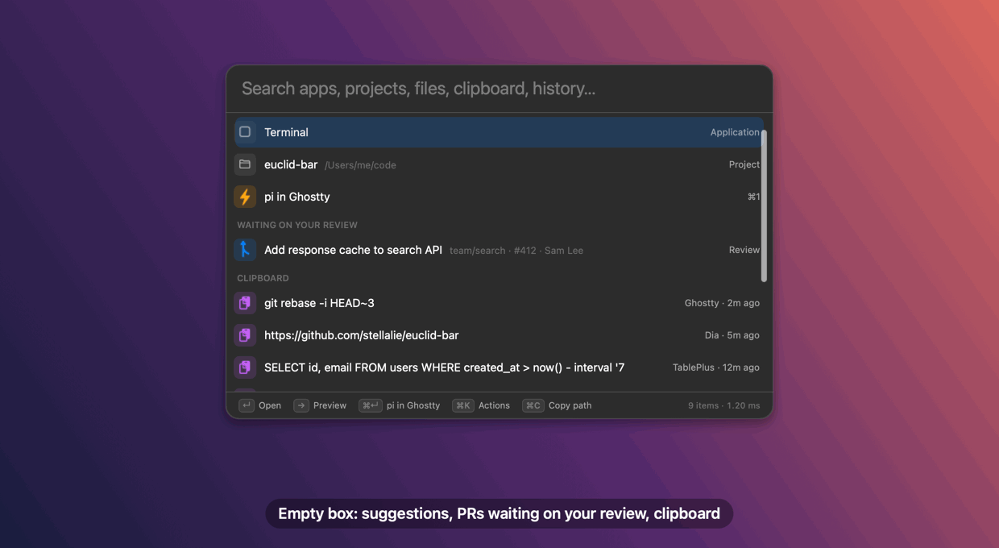
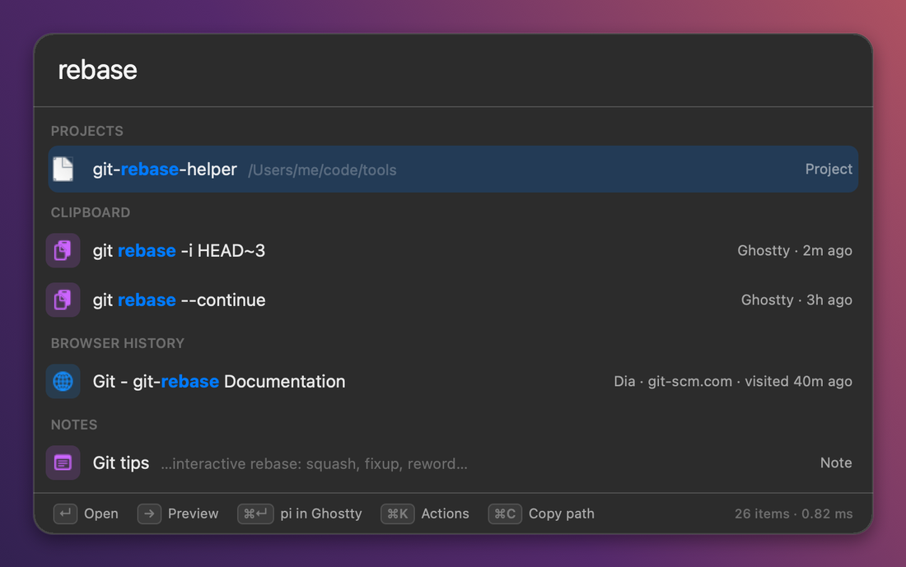
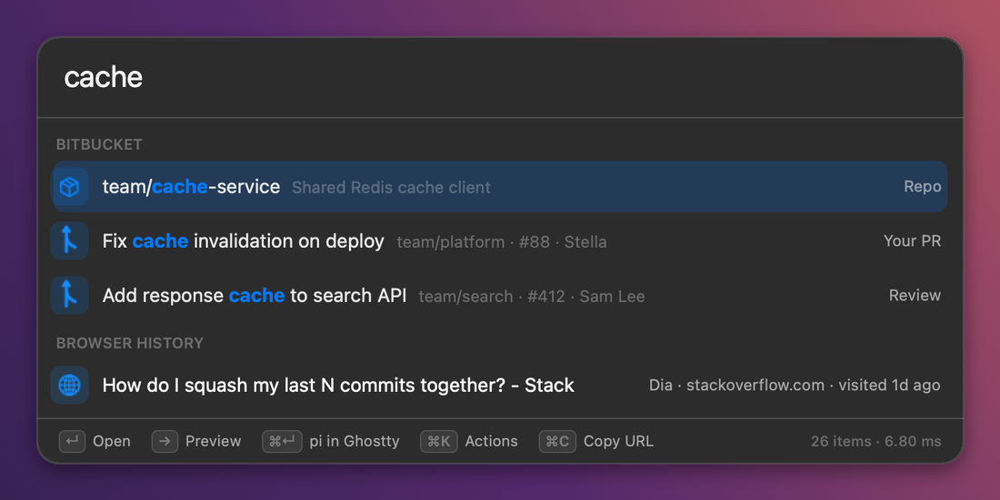
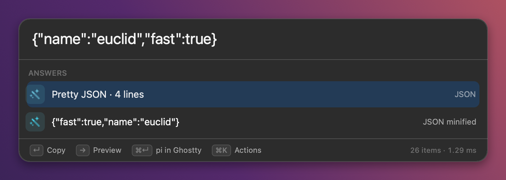
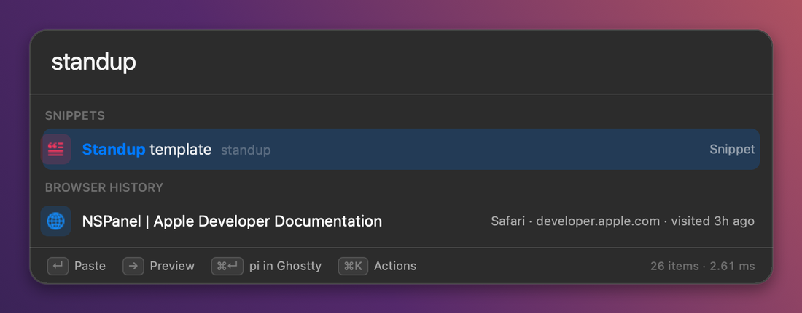
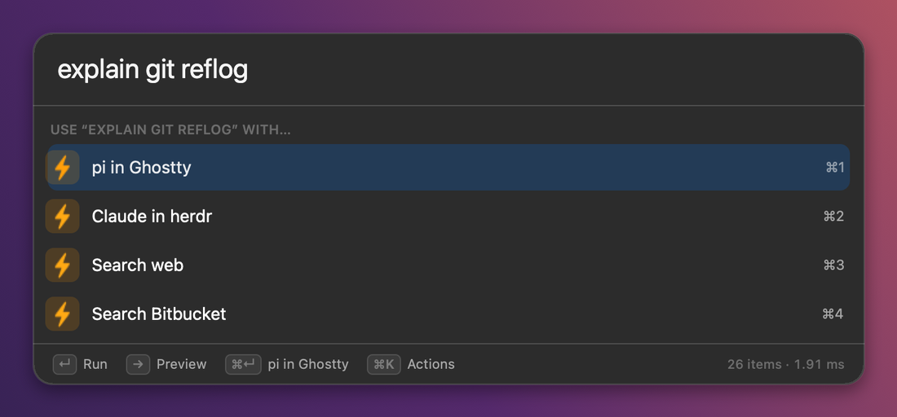
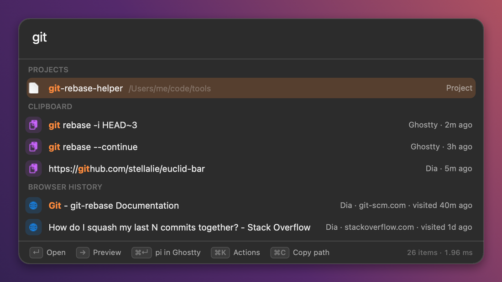
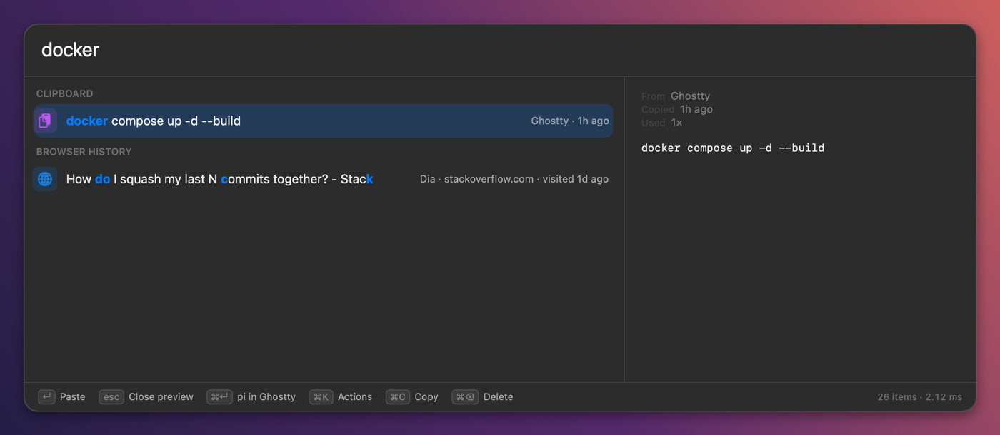

<div align="center">


# Meet Euclid

**The blazing fast, developer-first search bar for macOS.**<br>
Apps, projects, files, clipboard, browser history, notes, snippets and your Bitbucket PRs.
One keystroke, under a millisecond.

[**Download for macOS**](https://github.com/stellalie/euclid-bar/releases/latest) · [Features](#features) · [Config](#configuration) · [Bitbucket](#bitbucket) · [Build from source](#build-from-source)



<sub>Every frame is the real panel, rendered offscreen by the app itself (`make screens`)</sub>

</div>

---

Press **`⌥Space`**. Type three letters. The command you copied an hour ago, the docs page you read
yesterday, the PR waiting on your review, the question you want to throw at your AI agent: it's all
one keystroke away. Then Euclid gets out of your way.

## Why Euclid

- ⚡ **Blazing fast.** Native Swift + AppKit. No Electron, no web views. Searches **10,000 items in
  under a millisecond**, opens in ~20 ms, idles at ~0% CPU and ~30 MB of RAM. The footer shows you
  the receipts: `26 items · 0.82 ms`.
- 🛠️ **Built for developers.** Every action is **one shell command** in a TOML file. Epochs, JSON,
  JWTs, base64 and colours are answered inline. First-class Ghostty, herdr and Bitbucket.
- 🧩 **Config is a file, not a settings window.** `~/.config/euclid/config.toml`, dotfiles-friendly,
  applies on save, validated with `--check-config` in CI.
- 🔒 **Private by design.** Everything is indexed and stored on your Mac. Password-manager copies are
  never recorded. Browser history is read locally, read-only.

## Features

**One list, everything in it.** Results are grouped into sections with matched letters highlighted,
and the list never reshuffles under your cursor.

| Source | What you get |
|---|---|
| **Apps** | `/Applications`, `/System/Applications`, `~/Applications` and any folders you add |
| **Projects** | Git repos under your code folders; `↵` opens them in your editor of choice |
| **Files** | Spotlight, by name, after 3+ letters |
| **Clipboard** | Text, **images** and copied **files**, with the app and time they came from |
| **Browser history** | Dia, Arc, Chrome, Brave, Edge, Vivaldi, Chromium, Safari |
| **Page text** *(opt-in)* | Full-text search of the public pages you visited, indexed locally |
| **Obsidian** | Your notes by title and text; `↵` opens them in Obsidian |
| **Bitbucket** | Your open PRs, PRs waiting on your review, your repos (Cloud and Data Center) |
| **Snippets** | Text you paste often, with `{date}` `{time}` `{clipboard}` `{uuid}` placeholders |
| **Actions** | Your shell commands, run on what you typed |

**Answers as you type.** `↵` copies the answer.

| Type | Get |
|---|---|
| `12 * 3.5` · `1.5 gb in mb` · `72 f in c` | Calculator and unit conversions |
| `1697040000` · `2023-10-11T16:00:00Z` · `now` | Epoch ⇄ date |
| `{"a":1}` | Pretty and minified JSON |
| `eyJhbGciOi…` | Decoded JWT header and payload |
| `b64 hello` · `aGVsbG8gd29ybGQ=` | Base64 encode / decode |
| `a%20b` · `urlencode a b` | URL decode / encode |
| `#ff8800` · `rgb(255, 136, 0)` | The other notation, with a swatch |
| `uuid` | A fresh UUID |

**And the rest.**

- 👀 **Preview pane** (`→` or `⌘Y`): the full clip, images, Quick Look for files, a project's README,
  an indexed page's text.
- 🧠 **Learns what you mean.** The result you pick for what you type ranks first next time. Give
  anything a short **alias** and pin **favorites** to the empty box.
- 🤖 **Agent-ready.** Nothing matches? Your actions show up instead, so a question is one `↵` away
  from `pi`, `claude` or any agent in a new Ghostty or herdr tab.
- 🎨 **Sharp and light.** Liquid Glass on macOS 26, a panel that grows with its results, your own
  accent colour, `comfortable` or `compact` density.

## A closer look

<table>
<tr>
<td width="50%"><br><sub><b>Sections.</b> Matched letters highlighted, search time in the footer.</sub></td>
<td width="50%"><br><sub><b>Bitbucket.</b> Your PRs, review requests and repos.</sub></td>
</tr>
<tr>
<td><br><sub><b>Developer answers.</b> Paste JSON, get it pretty or minified.</sub></td>
<td><br><sub><b>Snippets.</b> The keyword pins it first; <code>↵</code> pastes.</sub></td>
</tr>
<tr>
<td><br><sub><b>No match?</b> Your actions are right there.</sub></td>
<td><br><sub><b>Yours.</b> <code>density = "compact"</code>, <code>accent = "#ff8a3d"</code>.</sub></td>
</tr>
</table>

<br>
<sub><b>Preview.</b> <code>→</code> opens the full clip, image, file, README or page next to the results.</sub>

## Keys

| Key | What happens |
|---|---|
| `⌥Space` | Summon Euclid over any app (configurable) |
| *type* | Search everything, instantly |
| `↵` | Open the app, project, file, page, note or PR · paste the clip or snippet · run the action · copy the answer |
| `⌘↵` | Run your **#1 action** on what you typed |
| `⌘1`–`⌘9` | Run action N |
| `⌘K` | Action palette: `↑↓` `↵`, `1`–`9`, type to filter |
| `→` / `⌘Y` | Preview the selection |
| `⌘C` | Copy the clip, or a page's URL, or an app, project or file's path |
| `⌘⌫` | Delete the selected clip |

## Install

1. **Download** `euclid-bar-<version>-macos-universal.zip` from
   [Releases](https://github.com/stellalie/euclid-bar/releases/latest) (Apple Silicon + Intel,
   macOS 14+).
2. **Unzip** and drag `euclid-bar.app` into `/Applications`.
3. **First launch:** Euclid isn't notarized by Apple (yet), so macOS blocks it the first time. Run
   ```sh
   xattr -dr com.apple.quarantine /Applications/euclid-bar.app
   ```
   or open it once, then click **Open Anyway** in **System Settings › Privacy & Security**.
4. Press **`⌥Space`**. The 🧠 in your menu bar has *Edit Config…* and *Quit*.

**Permissions** (asked only when needed):
- **Accessibility**: for `↵` to paste into the previous app. Without it, Euclid copies instead.
- **Automation**: the first time an action drives Ghostty.
- **Full Disk Access** *(optional)*: only to include Safari history.

## Actions

Actions live in `config.toml`, in order (first = `⌘1` and `⌘↵`). Your query arrives as `$1`
(`$EUCLID_QUERY_URL` is URL-encoded). It's passed as an argument and never pasted into the command,
so quotes, `$(…)` or backticks in what you type can't run anything.

```toml
[[action]]                                   # ⌘1, and ⌘↵
name = "Ask pi in a new Ghostty tab"
run  = 'ghostty-run tab pi "$1"'             # or: split, window

[[action]]                                   # ⌘2
name = "Claude in a herdr split"
run  = 'herdr-run split claude "$1"'         # or: tab, split-down

[[action]]
name  = "Search GitHub code"
alias = "gh"                                 # `gh swift testing` runs it on "swift testing"
run   = 'open "https://github.com/search?type=code&q=$EUCLID_QUERY_URL"'

[[action]]
name = "Open repo"                           # type: stellalie/euclid-bar
run  = 'open "https://github.com/$1"'

[[action]]
name = "man page in Ghostty"
run  = 'ghostty-run tab man "$1"'

[[action]]
name = "Pretty-print JSON to clipboard"
run  = 'printf %s "$1" | jq . | pbcopy'
```

`ghostty-run` and `herdr-run` are small scripts Euclid installs into `~/.config/euclid/bin` (on
`PATH` for every action). Read them, tweak them, or drop your own scripts next to them.

## Configuration

`~/.config/euclid/config.toml` is created with comments on first launch and **applies on save**. A
typo never breaks the app: the last good config stays active and the error shows in the panel footer.
Unknown keys are flagged too.

<details open>
<summary><b>Full reference</b></summary>

```toml
hotkey = "opt+space"                          # cmd, opt, ctrl, shift + a–z, 0–9, space, return, tab, f1–f12

[clipboard]
limit       = 5000                            # entries kept (applies on next launch)
ignore_apps = ["com.1password.1password"]     # bundle IDs never recorded

[shell]
path = "/bin/zsh"                             # actions run as a login shell (-l)

[env]                                         # extra env vars for every action
AWS_PROFILE = "my-profile"                    # e.g. what you only export in ~/.zshrc

[history]
enabled  = true
browsers = ["dia", "safari"]                  # default: every browser found
limit    = 5000

[apps]
enabled = true
folders = ["~/Tools"]                         # on top of /Applications and friends

[projects]
roots = ["~/code"]                            # git repos under these show up in search
depth = 3
open  = 'code "$1"'                           # how ↵ opens one ($1 = the repo's path)

[files]
enabled = true                                # Spotlight, by name, after 3+ letters
limit   = 8

[search]
favorites = ["Ghostty", "euclid-bar"]         # shown first when the box is empty

[aliases]
code = "Visual Studio Code"                   # type `code` ↵

[appearance]
accent     = "#7c5cff"                        # selection + match highlight (default: system accent)
density    = "comfortable"                    # or "compact"
glass      = true                             # Liquid Glass on macOS 26+
show_speed = true                             # "12,431 items · 0.6 ms" in the footer

[pages]                                       # full-text search of pages you visited
enabled       = false                         # off by default
limit         = 500
exclude_hosts = ["internal.example.com"]

[obsidian]
vault = "~/Notes"

[bitbucket]                                   # see below
email = "you@example.com"

[[snippet]]
name    = "Standup"
keyword = "standup"                           # typing it pins the snippet first
text    = """
Yesterday:
Today:
Blockers: none ({date})
"""

[[action]]
name   = "Search web"
alias  = "g"
run    = 'open "https://www.google.com/search?q=$EUCLID_QUERY_URL"'
```

</details>

About `[pages]`: when on, Euclid downloads recent pages from your history **without cookies** (so
only what's public) and indexes their text locally. Logins, password resets and URLs with query
strings are skipped.

Validate it from a terminal (great in dotfiles CI):

```sh
/Applications/euclid-bar.app/Contents/MacOS/euclid-bar --check-config
```

Clipboard history, the page index and learned ranking live in `~/Library/Application Support/Euclid`,
separate from the config, so they never end up in your dotfiles repo.

## Bitbucket

Your open PRs, PRs waiting on your review and your repos show up in search, and review requests are
on the empty box. Refreshed in the background every 5 minutes. The token never goes in
`config.toml`: Euclid runs `token_command` to read it, from the macOS Keychain by default.

**Bitbucket Cloud**

1. Create an API token at [id.atlassian.com › Security › API tokens](https://id.atlassian.com/manage-profile/security/api-tokens).
2. Store it in the Keychain:
   ```sh
   security add-generic-password -s euclid-bitbucket -a "$USER" -w '<token>'
   ```
3. Add your Atlassian email to `config.toml`:
   ```toml
   [bitbucket]
   email = "you@example.com"
   repos = ["workspace/repo"]       # optional: where to look for review requests
                                    # (default: your 10 most recently updated repos)
   ```

**Bitbucket Data Center**

1. Create an HTTP access token in your Bitbucket profile and store it the same way (step 2 above).
2. Point Euclid at your server, with no email:
   ```toml
   [bitbucket]
   base_url = "https://bitbucket.example.com"
   ```

**All options**

```toml
[bitbucket]
enabled         = true
email           = "you@example.com"                                  # Cloud only
base_url        = "https://api.bitbucket.org/2.0"                    # the default (Cloud)
token_command   = "security find-generic-password -s euclid-bitbucket -w"   # the default
repos           = ["workspace/repo"]                                 # Cloud only
refresh_minutes = 5                                                  # 1–120
```

Prefer 1Password? `token_command = "op read op://Private/Bitbucket/token"`.

## Build from source

Requires Xcode 16+ (Swift 6) on macOS 14+. Check what your Mac will build with:

```sh
swift --version   # needs "Swift version 6" or newer
xcode-select -p   # which Xcode or Command Line Tools is active
```

If it says Swift 5, point it at a newer Xcode with `sudo xcode-select -s /Applications/Xcode.app`,
or for one build without sudo, `DEVELOPER_DIR=/Applications/Xcode.app/Contents/Developer make run`.
Every `make` target checks this first and prints the fix.

```sh
git clone https://github.com/stellalie/euclid-bar && cd euclid-bar
make run       # build build/euclid-bar.app and launch it
make test      # unit tests
make perf      # release-mode search benchmarks
make screens   # render every panel state + docs/flow.gif from the real UI
```

<details>
<summary>Project layout</summary>

```
Sources/EuclidCore   UI-free logic: search, clipboard, history, content index, transforms,
                     snippets, Bitbucket client, config, actions
Sources/EuclidBar    AppKit app: hotkey, panel, preview, menu bar, screenshot/icon renderers
Tests/               Swift Testing
scripts/             bundle.sh, release.sh, make-dev-cert.sh, check-toolchain.sh,
                     test-core-linux.sh (core tests on Linux)
```

`make cert` creates a local signing identity so macOS keeps Accessibility permission across
rebuilds. Every PR that touches the app renders fresh screenshots in CI (the *UI screens* check).
</details>

## Roadmap

- Stream an action's output into the panel (`output = "panel"`): ask `pi --print`, `↵` pastes the answer
- Meaning-based search across history, pages and notes
- A shared local memory that Euclid and your coding agents can both read

## License

[MIT](LICENSE) © Stella Lie
