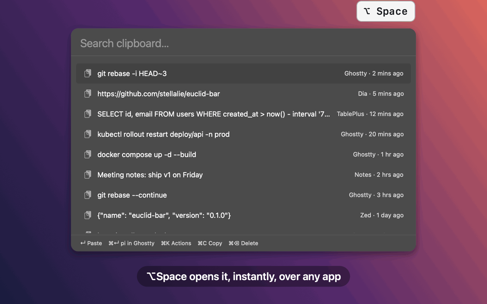

# euclid-bar

**Clipboard history + actions launcher for macOS.** Press `⌥Space`, find anything
you copied in under a millisecond, or send what you typed to any CLI: `pi`,
`claude`, a browser search, your own scripts.



<sub>[MP4 version](docs/demo.mp4) · rendered from the real panel UI with `make demo`</sub>

- ⚡ **Instant**: native Swift + AppKit, sub-millisecond fuzzy search over 5,000 clips, ~19 MB of RAM
- 🔒 **Private**: history stays on your Mac; password-manager copies are never recorded
- 🧩 **Any CLI is an action**: one line of TOML each, numbered `⌘1`–`⌘9`, listed under `⌘K`
- 🖥️ **Terminal-native**: open `pi`/`claude` in a new Ghostty tab or split, or a herdr pane

## Run

```sh
make run     # build build/euclid-bar.app and launch it
make test    # unit tests
make perf    # release-mode search benchmark
make log     # live timings (show / search)
make cert    # one-time: stable signing identity so Accessibility permission survives rebuilds
```

## Keys

| Key | Action |
|---|---|
| `⌥Space` | Toggle panel (set `hotkey` in config) |
| `↵` | Paste clip into the previous app / run selected action |
| `⌘↵` | Run action #1 |
| `⌘1`–`⌘9` | Run action N |
| `⌘K` | Action list: `↑↓` `↵`, `1`–`9`, type to filter, `esc` back |
| `⌘C` / `⌘⌫` | Copy / delete selected clip |
| `esc` | Close |

When no clip matches, the actions are listed instead.

## Config

`~/.config/euclid/config.toml` (or `$XDG_CONFIG_HOME/euclid`, or `$EUCLID_CONFIG_DIR`).
Created with comments on first launch; applied on save. A broken file keeps the
last good config and shows the error in the panel footer.

```toml
[[action]]                      # ⌘1 (and ⌘↵)
name = "Search web"
run  = 'open "https://www.google.com/search?q=$EUCLID_QUERY_URL"'
```

Actions run as `<shell> -l -c '<run>' euclid "<query>"`: the query is `$1` /
`$EUCLID_QUERY` (`$EUCLID_QUERY_URL` URL-encoded) and is never spliced into the
command. Scripts in `~/.config/euclid/bin` are on PATH; Euclid installs
`ghostty-run tab|split|window <cmd…>` there (never overwritten, edit freely):

```toml
run = 'ghostty-run tab pi "$1"'
```

Validate with `build/euclid-bar.app/Contents/MacOS/euclid-bar --check-config`.

Data (clipboard history) stays in `~/Library/Application Support/Euclid`
(or `$EUCLID_DATA_DIR`), so it never ends up in dotfiles. Password-manager
copies (`org.nspasteboard.ConcealedType` etc.) are never recorded.

## Speed budgets

| Moment | Target |
|---|---|
| Hotkey → panel visible | < 30 ms |
| Keystroke → results drawn | < 8 ms |
| Idle memory (phys footprint) | < 50 MB |

## Layout

```
Sources/EuclidCore   UI-free logic (search; later calculator, AI)
Sources/EuclidBar    AppKit app (hotkey, panel, results)
Tests/               Swift Testing
```
